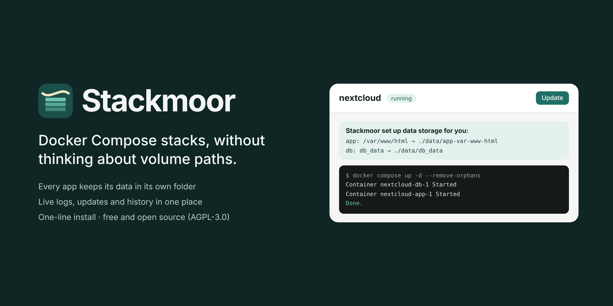

<p align="center"></p>

# Stackmoor

Prosty webowy panel do stacków Docker Compose – w duchu Dockge, ale bez myślenia o ścieżkach wolumenów. Każdy stack trzyma dane we własnym folderze, gotowym do backupu.

[English](README.md)

> **Status:** wczesna wersja (v0.1). Zarządzanie stackami działa; backupy, domeny lokalne i kreator instalacji są w planie.

## Instalacja

Na czystym Debianie, Ubuntu albo Raspberry Pi OS (x86_64 lub arm64):

```bash
curl -fsSL https://raw.githubusercontent.com/gadziunet/stackmoor/main/install.sh | sudo bash
```

Skrypt instaluje Dockera, jeśli go brakuje, uruchamia Stackmoor i wypisuje adres, np. `http://192.168.1.50:5001`. Przy pierwszym wejściu tworzysz konto administratora.

Ponowne uruchomienie tego samego polecenia aktualizuje panel. Opcjonalnie: `curl ... | sudo PORT=8080 STACKS_DIR=/srv/stacks bash`.

> Stackmoor ma dostęp do gniazda Dockera, czyli pełną kontrolę nad maszyną. Trzymaj go w sieci lokalnej albo za VPN.

## Co potrafi

- lista stacków ze statusem na żywo
- tworzenie stacka przez wklejenie `compose.yaml` (+ opcjonalny `.env`)
- edytor z walidacją przez `docker compose config` – błędny plik nie zostanie zapisany
- Uruchom, Restart, Aktualizuj (pull + up), Zatrzymaj, Wyłącz – z wyjściem na żywo
- logi na żywo, kontenery z portami, historia operacji
- usuwanie stacka przenosi folder do `.trash/` – nic nie znika przypadkiem
- interfejs po polsku i angielsku

## Automatyczne wolumeny

Nie wpisujesz ścieżek na hoście. Każdy stack ma folder `/opt/stacks/<nazwa>/`, a dane aplikacji lądują w `/opt/stacks/<nazwa>/data/`:

| W compose | Po zapisie |
|---|---|
| `- /config` | `- ./data/app-config:/config` |
| `- /jakas/sciezka:/config` | `- ./data/app-config:/config` |
| `- db_data:/var/lib/mysql` | `- ./data/db_data:/var/lib/mysql` |
| nic, ale obraz ma `VOLUME /data` | przy uruchomieniu dopisywane `- ./data/app-data:/data` |

Bez zmian zostają: ścieżki systemowe (`docker.sock`, `/dev`, `/etc/localtime`…), ścieżki z listy dozwolonych w Ustawieniach (domyślnie `/mnt`, `/media` – np. dyski z filmami, bez backupu), ścieżki z `${ZMIENNYMI}`, ścieżki względne wewnątrz stacka i wolumeny `external`.

Panel pokazuje po zapisie, co zmienił. Foldery tworzy przed startem z właścicielem `PUID:PGID` (domyślnie 1000:1000), żeby nie powstały jako root. Jeśli aplikacja montuje pojedynczy **plik** (np. `nginx.conf`), panel nie pozwoli wystartować bez niego, bo Docker utworzyłby w tym miejscu pusty folder.

Automatyczne wolumeny można wyłączyć dla wybranego stacka.

## Przeniesienie aplikacji z innego panelu (np. Dockhand)

1. Utwórz `/opt/stacks/<nazwa>/data/` i skopiuj tam dane aplikacji (dokładną nazwę podfolderu panel pokaże po zapisie compose).
2. Zatrzymaj aplikację w starym panelu.
3. W Stackmoor utwórz stack z tym samym compose – ścieżki zostaną przepięte na `./data/...`.
4. Uruchom i sprawdź.

Stack można utworzyć w istniejącym folderze bez `compose.yaml`, więc dane możesz wgrać wcześniej.

## Domeny lokalne

Każdy stack może dostać adres typu `chmura.dom.example.com` z prawdziwym certyfikatem HTTPS – bez pamiętania portów i bez wystawiania serwera do internetu.

1. **Ustawienia → Domeny:** wpisz domenę, wybierz dostawcę DNS (Cloudflare, Bunny, OVHcloud, Hetzner, DigitalOcean, Porkbun, Namecheap, GoDaddy, IONOS, netcup, Gandi, AWS Route 53, deSEC, DuckDNS) i wklej klucz API. Klucze są zapisywane w formie zaszyfrowanej.
2. W DNS utwórz rekord A `*.dom.example.com` → adres IP serwera (lokalny adres jest w porządku).
3. **Stack → Domena:** wybierz subdomenę, usługę i jej port w kontenerze.

Stackmoor uruchamia Caddy we własnym kontenerze (`stackmoor-caddy`) z jednym certyfikatem wildcard dla wszystkich aplikacji. Dostawcę DNS można zmienić w każdej chwili w Ustawieniach. Na Unraid porty 80/443 zajmuje jego panel – wybierz inne w sekcji *Zaawansowane*.

**Adres samego panelu.** Wpisz *Adres tego panelu* (np. `stackmoor`), a panel będzie dostępny także pod `https://stackmoor.dom.example.com`. Gdy otworzysz go pod tym adresem, możesz włączyć *Panel tylko pod tym adresem* – wejście przez IP przekieruje wtedy na domenę, jak w Cloudronie. Gdyby domena kiedyś przestała działać, odblokujesz panel poleceniem:

```bash
docker exec stackmoor node src/cli.js unlock
```

## Plan

- [x] Stacki, edytor, automatyczne wolumeny, logi
- [x] Domeny lokalne przez Caddy – certyfikat wildcard przez API dostawcy DNS (14 dostawców) albo wewnętrzny CA
- [ ] Backupy jak w Cloudronie – per stack, automatycznie przed aktualizacją, dumpy baz, harmonogram, retencja, szyfrowanie; restic do S3 / Backblaze B2; przywracanie i klonowanie
- [ ] Kreator: nowa instalacja albo przywrócenie wszystkiego z backupu
- [ ] Aktualizacje: sprawdzanie nowych wersji Stackmoor i nowych obrazów stacków (włączane w Ustawieniach), pokazanie co nowego i aktualizacja dopiero po potwierdzeniu

## Rozwój

```bash
npm install
STACKS_DIR=$HOME/stacks npm run dev   # http://localhost:5001
npm test
```

Wymaga Node 20+ oraz `docker` z wtyczką `compose`. Albo przez Dockera: `docker compose up -d --build` (ustaw `STACKS_DIR` w `.env`). Opis zmiennych i struktury plików – w [README po angielsku](README.md#development).

Tłumaczenia: dopisz blok języka w `src/i18n.js` i `public/i18n.js` – testy sprawdzają, czy każdy język ma wszystkie klucze.

## Jak powstaje

Stackmoor jest pisany z pomocą AI – [Claude](https://claude.ai) od Anthropic. Ja projektuję funkcje, przeglądam zmiany i każde wydanie sam testuję na prawdziwych serwerach (Debian i Unraid), zanim je opublikuję. Kod jest objęty testami automatycznymi uruchamianymi przy każdym pushu.

Jeśli znajdziesz błąd, [zgłoś go tutaj](https://github.com/gadziunet/stackmoor/issues).

## Licencja

[AGPL-3.0](LICENSE) © Gadziunet. Możesz używać, zmieniać i udostępniać Stackmoor za darmo; jeśli rozpowszechniasz zmienioną wersję albo udostępniasz ją jako usługę w sieci, musisz opublikować swoje zmiany na tej samej licencji.
